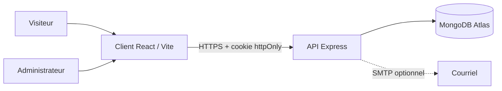
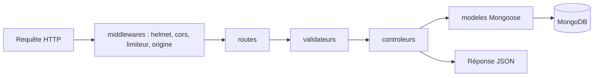
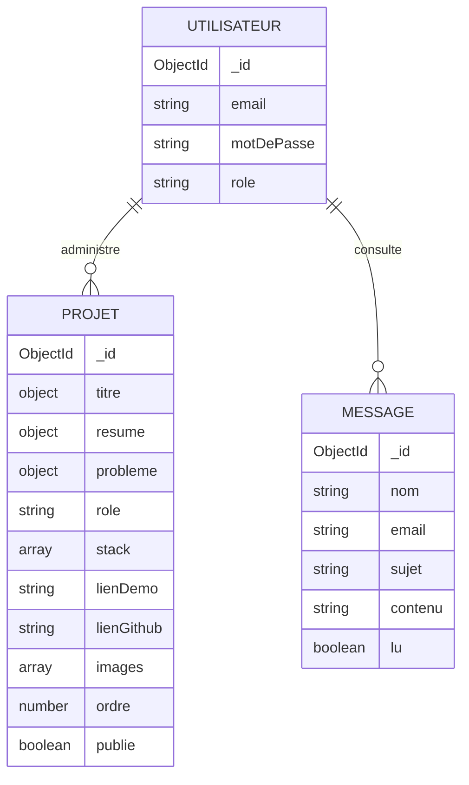
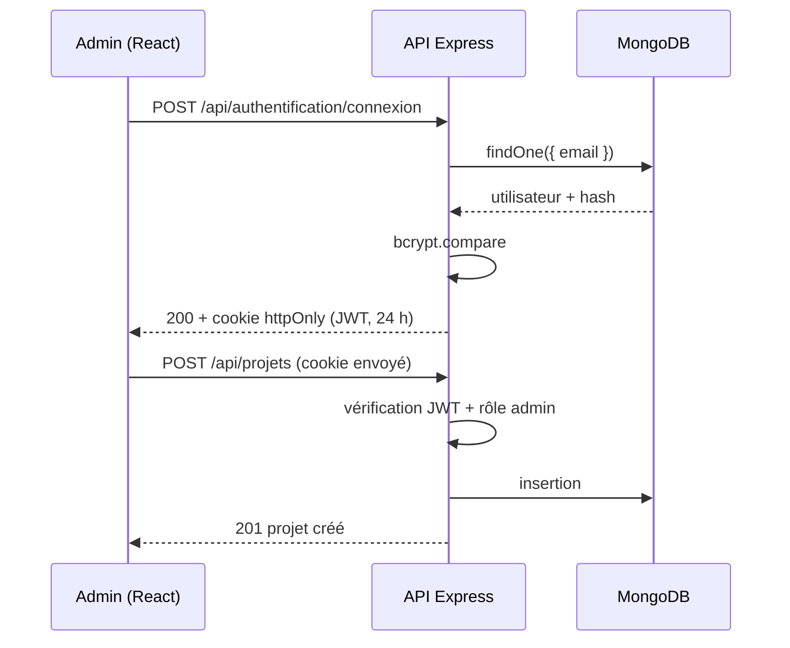

# Portfolio Full-Stack MERN - NDOUYI Harley Fedy

Portfolio complet : vitrine publique (React), API REST (Express), base MongoDB et tableau de bord administrateur.
Le site est lui-même une preuve de compétence full-stack : projets, messages et contenus sont gérés en base, sans redéploiement.

## Avancement

| Étape | Contenu | Statut |
|-------|---------|--------|
| 1 | Serveur : API, modèles, authentification, sécurité, tests | Livrée et validée en local (MongoDB local). Connexion à Atlas en cours |
| 2 | Front public : thèmes clair/sombre, sections, formulaire de contact, WCAG AA | À venir |
| 3 | Tableau de bord administrateur | À venir |
| 4 | Déploiement : Atlas, Render, Vercel | À venir |

## Versions

Node v22, npm 10, Express 4, Mongoose 8, React 18 (étape 2), Vite, Sass.

## Structure globale

```
portfolio/
    README.md
    .gitignore
    client/                          (étape 2 : React + Vite + Sass)
    serveur/                         (étape 1 : API Express)
        README.md
        package.json
        .env.exemple
        src/
            app.js                   (assemblage Express)
            serveur.js               (point d'entrée : connexion BD + écoute)
            configuration/           (variables d'environnement, base de données)
            modeles/                 (M : schémas Mongoose)
            controleurs/             (C : logique de chaque route)
            routes/                  (association URL -> contrôleur)
            middlewares/             (authentification, erreurs, limiteurs, validation, CSRF)
            validateurs/             (règles express-validator)
            services/                (courriel)
            utilitaires/             (JWT, erreurs, helpers)
            scripts/                 (création de l'administrateur)
        tests/
```

## Diagrammes

### Architecture



### Flux d'une requête (MVC)



### Modèle de données



Les relations sont logiques (pas de clé étrangère) : il n'y a qu'un seul administrateur.

### Authentification


## Journal d'avancement (07-08 octobre 2026)

- Cadrage : positionnement, cibles, compétences, parcours, design (`#16213e`, thèmes clair et sombre, WCAG AA)
- Étape 1 : API REST en architecture MVC (Utilisateur, Projet, Message) et sécurité
- Authentification JWT en cookie `httpOnly`, un seul administrateur
- Scripts `admin:creer` et `admin:reinitialiser`
- 7 tests automatisés réussis
- Vérifications en réel sur MongoDB local : connexion, session, création du projet Nody, lecture publique, refus sans session (401)
- Prochaine étape : connexion à MongoDB Atlas, puis front React

Reste à tester : modification et suppression de projets, routes de messages, envoi d'email (SMTP), cookies en production.

## Démarrage rapide

Voir [serveur/README.md](serveur/README.md).

## Convention de commits

`feat`, `fix`, `docs`, `test`, `chore`, `refactor`, avec la portée : `feat(serveur): ajoute le modèle Projet`.
