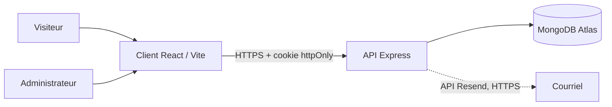
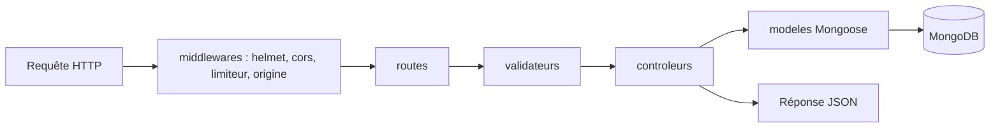
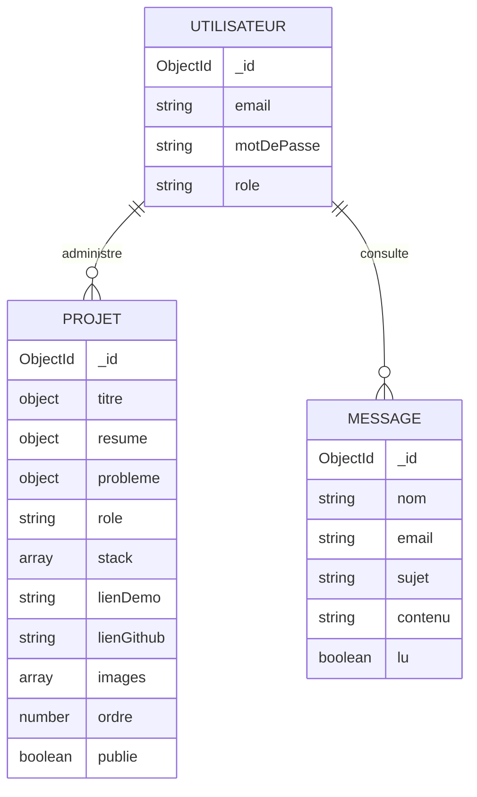
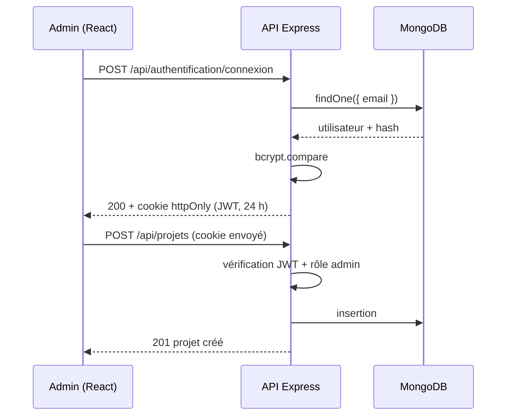

# Portfolio Full-Stack MERN - NDOUYI Harley Fedy

Portfolio complet : vitrine publique (React), API REST (Express), base MongoDB et tableau de bord administrateur.
Le site est lui-même une preuve de compétence full-stack : projets, messages et contenus sont gérés en base, sans redéploiement.

Site en ligne : https://harley-ndouyi.vercel.app

## Avancement

| Étape | Contenu                                                                      | Statut                                        |
| ----- | ---------------------------------------------------------------------------- | --------------------------------------------- |
| 1     | Serveur : API, modèles, authentification, sécurité, tests                    | Livrée et validée (MongoDB local, puis Atlas) |
| 2     | Front public : thèmes clair/sombre, sections, formulaire de contact, WCAG AA | Livrée et fusionnée dans `main`               |
| 3     | Tableau de bord administrateur                                               | Livrée et fusionnée dans `main`               |
| 4     | Déploiement : Atlas, Render, Vercel                                          | Livrée en production                          |

## Versions

Node v22.13.0, npm 10.9.0, Express 4, Mongoose 8, React 19.3.0, Vite 8.3.4, react-router-dom 7.18.4, axios 1.20.0, Sass 1.105.1.

## Structure globale

```
portfolio/
    README.md
    client/                          (étape 2 : React + Vite + Sass)
        .env.exemple
        vercel.json                  (proxy /api vers Render + repli application monopage)
        public/                      (images, CV, favicons, robots.txt)
        src/
            composants/              (V : miseEnPage, sections, ui)
            contextes/               (C : thème et langue)
            hooks/                   (C : logique réutilisable)
            services/                (M : appels à l'API via axios)
            donnees/                 (contenus statiques)
            traductions/             (fr.json, en.json)
            pages/
            styles/                  (Sass : abstracts, base, composants)
    serveur/                         (étape 1 : API Express)
        README.md
        package.json
        .env.exemple
        src/
            app.js                   (assemblage Express)
            serveur.js               (point d'entrée : connexion BD + écoute)
            configuration/           (variables d'environnement, base de données)
            modeles/                 (M : schémas Mongoose)
            controleurs/             (C : logique de chaque route)
            routes/                  (association URL -> contrôleur)
            middlewares/             (authentification, erreurs, limiteurs, validation, CSRF)
            validateurs/             (règles express-validator)
            services/                (courriel : notification via l'API Resend)
            utilitaires/             (JWT, erreurs, helpers)
            scripts/                 (création de l'administrateur)
        tests/
```

## Diagrammes

### Architecture



### Flux d'une requête (MVC)



### Modèle de données



Les relations sont logiques (pas de clé étrangère) : il n'y a qu'un seul administrateur.

### Authentification



## Journal d'avancement (07-08 octobre 2026)

- Cadrage : positionnement, cibles, compétences, parcours, design (`#16213e`, thèmes clair et sombre, WCAG AA)
- Étape 1 : API REST en architecture MVC (Utilisateur, Projet, Message) et sécurité
- Authentification JWT en cookie `httpOnly`, un seul administrateur
- Scripts `admin:creer` et `admin:reinitialiser`
- 7 tests automatisés réussis
- Vérifications en réel sur MongoDB local : connexion, session, création du projet Nody, lecture publique, refus sans session (401)
- Prochaine étape : connexion à MongoDB Atlas, puis front React

Reste à tester à ce stade : modification et suppression de projets, routes de messages, envoi d'email et cookies en production (ces deux derniers points ont été traités à l'étape 4).

## Journal d'avancement (étape 2, 13-14 octobre 2026)

- Front React (Vite) : thèmes clair/sombre, bilingue FR/EN, navigation au clavier, lien d'évitement
- Sections : Accueil, À propos, Compétences, Services, Projets (galerie accessible), Parcours, Contact
- Projets chargés depuis l'API (`/api/projets`), formulaire de contact relié à `/api/messages`
- SEO de base : métadonnées, Open Graph, favicons, `robots.txt`
- Lighthouse (build de production, mobile) : 99 performance, 100 accessibilité, 100 bonnes pratiques, 100 SEO
- Prochaine étape : tableau de bord administrateur

## Journal d'avancement (étape 3, octobre 2026)

- Tableau de bord administrateur sous `/admin`, chargé à la demande (`React.lazy`) : le site public n'appelle jamais `/api/authentification/moi`
- Connexion par cookie `httpOnly`, session restaurée au rechargement, routes protégées (`RouteProtegee`)
- Gestion des projets : liste, création, modification, publication/dépublication, suppression avec confirmation nominative
- Gestion des messages : liste, marquer lu/non lu, suppression avec confirmation
- Formulaires accessibles : label relié, erreurs annoncées (`aria-invalid`, `aria-describedby`), focus sur le premier champ en erreur
- Validation serveur renforcée : titre et résumé en français obligatoires, chemins d'images restreints à `/images/projets/<nom>.(webp|png|jpg|jpeg)`

### Règles métier

- **Ordre des projets** : à la création, si le champ est vide, le serveur attribue le plus grand `ordre` existant + 1 (plafond 999). Le champ reste modifiable ensuite. Les projets s'affichent par `ordre` croissant.
- **Images** : noms de fichiers en minuscules avec tirets, par exemple `nody-accueil.webp`. Le nom de fichier sert de clé de traduction : `projets.legende.<nom>` et `projets.alt.<nom>` dans `fr.json` et `en.json`.

### Points reportés à l'étape 4 (tous traités)

- Contraste du bouton « Confirmer la suppression » : mesuré, conforme AA (au moins 4,5 : 1) dans les thèmes clair et sombre
- Envoi d'email et cookies en production : traités, voir le journal de l'étape 4
- Déploiement (Atlas, Render, Vercel) : voir le journal de l'étape 4

## Journal d'avancement (étape 4, octobre-novembre 2026)

### Architecture de production

Visiteur → Vercel (client React, `/api/*` réécrit) → Render (API Express) → MongoDB Atlas

- **Client** : Vercel, dossier racine `client`, variable `VITE_API_URL=/api`. Le fichier `client/vercel.json` redirige `/api/*` vers l'API Render et renvoie les autres routes vers `index.html` (application monopage).
- **API** : Render (plan gratuit), branche `main`, déploiement automatique à chaque fusion. Après une période d'inactivité, la première requête peut prendre environ 50 secondes.
- **Base de données** : MongoDB Atlas. L'utilisateur applicatif est limité au rôle `readWrite` sur la seule base `portfolio` (moindre privilège). Render n'ayant pas d'adresse IP fixe, la liste d'accès réseau autorise `0.0.0.0/0`.
- **Même origine côté navigateur** : le cookie de session reste de premier niveau (`SameSite=Lax`).

### Sécurité en production

- Cookie de session `httpOnly`, `Secure` en production, `SameSite=Lax`, avec contrôle de l'en-tête `Origin` contre `CLIENT_URL` (protection CSRF).
- Limiteurs de débit en mémoire : global 300 requêtes / 15 min, connexion 5 tentatives / 15 min, contact 5 messages / 60 min.
- `trust proxy` vaut 4. Valeur mesurée dans les journaux Render : `X-Forwarded-For` contient 4 adresses (visiteur, Vercel, CDN Render, proxy interne Render). À remesurer si l'hébergement change, sinon le limiteur ne distingue plus les visiteurs.
- `robots.txt` interdit l'indexation de `/admin` (simple consigne pour les moteurs de recherche, pas une protection : l'accès reste protégé par l'authentification).

### Notification des messages par courriel

- Chaque message du formulaire de contact déclenche un courriel de notification, envoyé par l'API [Resend](https://resend.com) en HTTPS. Render bloque le SMTP (ports 25, 465 et 587) sur le plan gratuit, d'où ce choix.
- L'enregistrement en base reste prioritaire : l'appel à l'API n'est pas attendu, et une erreur d'envoi est seulement journalisée côté serveur.
- Variables d'environnement sur Render : `COURRIEL_CLE_API`, `COURRIEL_DESTINATAIRE` et, en option, `COURRIEL_EXPEDITEUR` (par défaut `Portfolio <onboarding@resend.dev>`).
- Limite : avec l'expéditeur de test `onboarding@resend.dev`, le destinataire doit être l'adresse du compte Resend. Écrire à d'autres adresses demanderait un domaine vérifié.

## Démarrage rapide

- API : voir [serveur/README.md](serveur/README.md)
- Client : voir [client/README.md](client/README.md)

## Convention de commits

`feat`, `fix`, `docs`, `test`, `chore`, `refactor`, avec la portée : `feat(serveur): ajoute le modèle Projet`.
